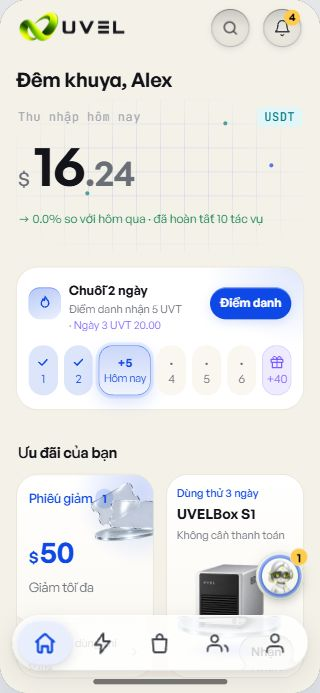

# R23 独立交互B小增量 — FROZEN / READY

2026-10-28 JST。只操作本人5263合成服务，范围为320×693越文浅色一例及原语言控件切换英文。指定小增量均9.3，无新增P0/P1/P2。**新增试用早购业务未签；钱包未签。** 不作为整包业务/推送验证结论。

## 精确指纹

- frozen root：D:/WORKS/PLAN/.wt/uvel-design-preview/r20-unified-review/r23-frozen-web。
- 实际DOM入口index-D78ONfqM.js / index-DPMvPy7r.css；两次DOM读取首尾核对冻结index.html及实际入口，记录各自lazy CSS。
- JS SHA256：D176E742E93D728543B0FE2880030F9B5CFD0C5E92C47DB3C424FD420037E20A；结束只读GET5263所服务JS，HTTP200且SHA256相同。
- 主CSS SHA256：361F8178B8E346B1B8C3A0E2E168938DE62036EEF456B13962803AD0E07FA80D。

## 单项评分

| 指定范围 | /10 | 独立实景 |
|---|---:|---|
| 320VI浅色USDT及金额几何 | 9.3 | 原图右上USDT完整单行，12px/500、nowrap，根44.729×19.333px，文字ink30.729px。标题至badge空隙116.385px，金额行间隔10px。实际$16.24，整数56px/小数36px，无挤压、换行或遮挡；文档clientWidth=scrollWidth320。 |
| 今天10.5px与蓝影快速回归 | 9.3 | Hôm nay实际10.5px/400/14px，文字约41.80px容于52px今天格；签到根44px。右上按钮shadow为主题蓝srgb0.054902/0.282353/0.901961、15% 0/3/10px，今天格边框同蓝60%、渐变22%→6%，原图可见蓝色光影。没有点击签到。 |
| 原语言切换英文USDT | 9.3 | 原“预览语言”选择English后，左侧变Today's earnings，今天格变Today，右上仍精确USDT、12px/500。仍320×693浅色，文档无横溢；只保存有界DOM，不另拍第二图。 |

[唯一原生截图](./compact-r23-interaction-b.jpg) · [有界DOM/geometry/首尾指纹](./compact-r23-interaction-b.json)

## 边界和收尾

- 一张原生手机区域截图，未编辑。DOM仅收益标题/角标/金额和签到指定节点，不借旧包评分；没有完整矩阵重跑。
- **新试用早购、订单/支付/购买守卫、钱包均N/T**，未触发、未检查，也不因合并成功或此UI小增量分数代签。截图下方偶含福利背景，不是早购验收证据。
- 仅切换尺寸、语言、主题；未点业务按钮、清storage或写store，未修改源码/构建/测试/commit/push，未操作其他端口或用户标签。
- 报告保存后关闭本人Chrome任务标签1733373055，5263服务保留。READY，所列小增量签核完成，不扩展范围。
