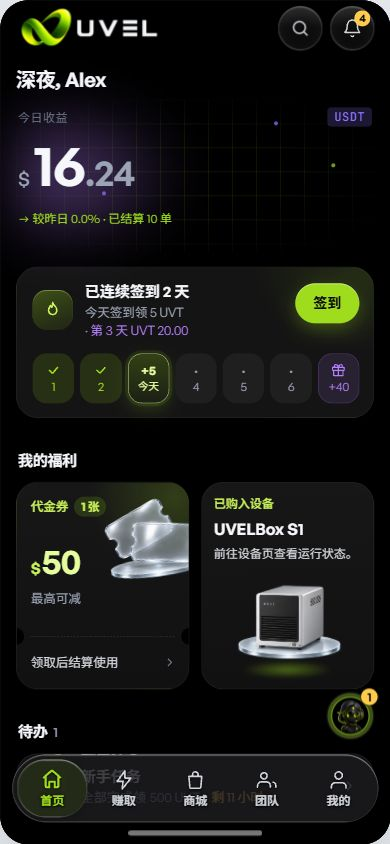

# R24 独立交互B只读核对 — FROZEN / READY

2026-10-28 JST。按本轮授权，仅新建本人临时Chrome标签1733373060打开http://127.0.0.1:5237/preview。没有操作用户IAB或既有标签；没有切换任何尺寸/语言/主题/演示状态控件，没有点击业务、清storage或写store。

## 指纹

- frozen root：D:/WORKS/PLAN/.wt/uvel-design-preview/r20-unified-review/r24-frozen-web。
- 实际DOM首尾均index-Ddn2nKUH.js / index-DPMvPy7r.css；冻结index.html首尾也一致，动态CSS列表保存在有界DOM。
- JS SHA256：4EAA6431B783308649C2116FE711C9B1527927CC912BDEE5D11116CFB20A96E8。结束只读GET5237实际JS，HTTP200、SHA256一致。
- 主CSS SHA256：361F8178B8E346B1B8C3A0E2E168938DE62036EEF456B13962803AD0E07FA80D。

## 当前一例读回

实际当前视图为**390×844、中文、暗色**，保持原状，不为扩展矩阵而切换。

| 项目 | 评分 | 真实证据 |
|---|---:|---|
| 首页USDT未裁切 | 9.3 | 完整USDT，12px/500、nowrap，字距0.48px；根44.729×19.333px，字形ink30.729px，padding2px7px。clientWidth=scrollWidth约45px；文档390/390无横溢。 |
| 金额间隔/完整性 | 9.3 | 左标题与角标间隔259.344px，金额行距header底10px。实际$16.24完整，整数56px/600、小数36px/600，未换行/压缩/遮挡。 |
| 今天10.5px | 9.3 | 今天实读10.5px/400/14px，文字ink21px，置于约41.52px今天格内，无裁切。只读取当前样式，不点击签到。 |

[唯一原生截图](./compact-r24-interaction-b.jpg) · [有界DOM/geometry及首尾指纹](./compact-r24-interaction-b.json)

无本轮新增P0/P1/P2。**iPhone校准、试用早购、钱包及其他矩阵/完整业务均未签**，截图下方福利背景不构成这些业务的验收证据；本报告不是整包或推送验证结论。

没有源码编辑、构建、测试、commit/push，也没有新建QA服务。存档后仅关闭本人临时Chrome标签，5237服务和用户IAB均保留。READY，不扩大范围。
